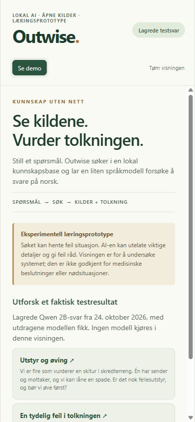
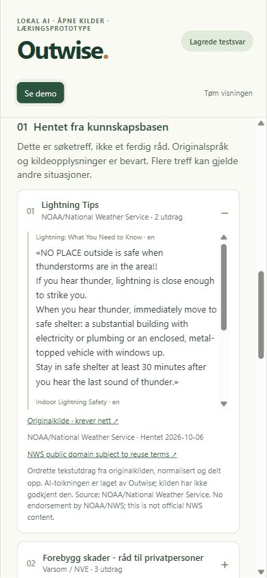
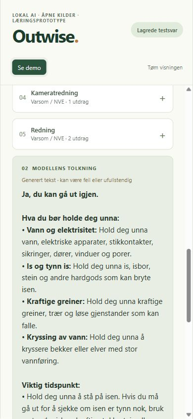
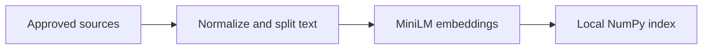
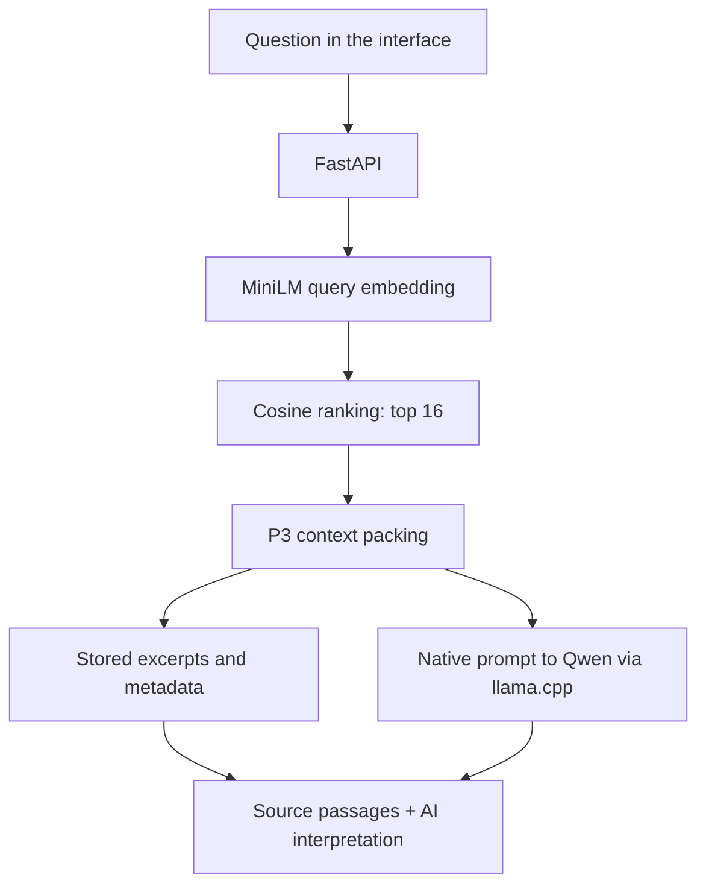

# Outwise

**A local outdoor-question assistant — and an experiment in how much a small AI preserves from its sources.**

Outwise searches an offline knowledge base and asks a small language model to answer
in Norwegian. It runs on a Windows PC, with a mobile-friendly browser interface.
Testing showed a clear limitation: useful information could be present in the
sources while the local model omitted it, changed its meaning or added wrong advice.

**This is a learning prototype. Reliable emergency guidance has not been demonstrated.**



## The short explanation

1. You describe a situation.
2. A search model finds related text in locally stored sources.
3. A language model tries to write an answer from that text.
4. The app automatically shows **the retrieved passages** and **the AI interpretation** in separate sections.

You can see what the model received and compare it with what it wrote. A source
link does not prove that the interpretation is correct. Each question is processed
independently; the chat display has no conversation memory.

No account or paid AI API is needed to run the application. Models and knowledge must first be installed locally.

### See what it looks like

You can understand the project from this README and the screenshots without
installing anything. The replay examples use two real, unchanged Qwen test answers
and their source passages. Replay mode is labeled and does not run a model.

| Retrieved source text | Automatically shown AI interpretation |
|---|---|
|  |  |

One example exposes a concrete failure: asked whether it was safe to leave shelter
after ten quiet minutes following thunder, Qwen answered yes. The supplied source
said to wait at least **30 minutes after the last thunder**. This is an example of
an incorrect test answer, not advice to follow.

## Main result: the same eight questions

The comparison used **six supported situations with 15 required information
criteria, plus two knowledge-gap questions**. All three generators received the
same questions and source text. Retrieval fully supplied **13/15 criteria**; the
other two were partially supplied.

| Generator | Fully covered required criteria | Appropriate abstention on knowledge gaps |
|---|---:|---:|
| Local Qwen3.5-2B baseline | **8/15** | 0/2 |
| Local Gemma 4 E2B baseline | **6/15** | 2/2 |
| GPT-6.1 Sol High reference | **13/15** | 2/2 |

These are coverage counts, **not percentages of correct or safe answers**. An answer
can preserve a required fact and also add an incorrect instruction. The fixed judge
recorded these additional findings:

| Generator | Answers with unsupported additions | Answers with critical omissions | Answers with direct conflicts |
|---|---:|---:|---:|
| Qwen baseline | 7/8 | 3/8 | 2/8 |
| Gemma baseline | 1/8 | 5/8 | 1/8 |
| GPT reference | 0/8 | 0/8 | 0/8 |

These are developmental judge flags, not clinically validated error rates. GPT had
one source-insufficiency item requiring review. Eight deliberately selected,
reused development questions do not establish broad reliability.

The rubric accepts equivalent meaning, but required conditions, ordering and
warnings must survive. The judge was **GPT-6.1 Sol Medium**. The larger-model
reference generated answers at **High** reasoning; it was an evaluation comparison,
not part of the offline app. Same-family judging, different reasoning/runtime and
GPT's lack of the local 512-token cap limit what this says about model size alone.

A bounded prompt/sampling round gave no clear overall improvement. The app
therefore retains the measured Qwen baseline, including its baseline prompt;
the later attempted prompt was not selected. We stopped general optimization as
a scope decision, not because better small-model RAG is impossible.

[Rubric, data quality, experiments and historical background →](docs/RESULTS.md)

## How it is built

**Stack:** Python, FastAPI, Expo/React Native, TypeScript, NumPy, local MiniLM and
Qwen models, and llama.cpp. The application has two separate flows.

### 1. Prepare the knowledge once



The fixed collection contains **22 approved URLs and 190 stored text chunks**.
[Ingestion](backend/outwise/knowledge/ingestion.py) normalizes the text, splits it
into sections/chunks and preserves source, date and reuse information.
[MiniLM indexing](backend/outwise/knowledge/window_index.py) converts the chunk
text into numerical vectors representing meaning. Full-body windows and combined
title/body views prevent a long chunk from being represented only by its beginning.
The vectors and their chunk identities are stored locally in a NumPy index.

### 2. Answer a question



[FastAPI](backend/outwise/routes/chat.py) passes the question to the
[orchestrator](backend/outwise/services/orchestrator.py). The local MiniLM model
embeds the question; [cosine similarity](backend/outwise/services/semantic_retrieval.py)
ranks eligible Norway/general chunks against the stored vectors. The app takes
the top 16 candidates with **no similarity threshold**. A high-ranked hit can
still concern the wrong situation.

[P3 packing](backend/outwise/services/context.py) removes duplicates and can include
small, adjacent groups from the same source section, within the fixed context
budget. It preserves stored text rather than asking another AI to summarize it.

The [native model service](backend/outwise/services/native_model.py) sends separate
system instructions and user content containing the question and packed passages
through Qwen's chat template to a local llama.cpp server. The model is
**Qwen3.5-2B Q4_K_M GGUF**, with thinking off and a 512-token answer limit.

The response includes the interpretation plus **exact stored excerpts and source
metadata**, supplied by application code. Titles and links are not invented by
the language model. Opening an original webpage requires internet; reading the
displayed excerpts does not.

No model weights were trained or changed. Research informed the evaluation and
settings; research papers were not added to the outdoor knowledge base.
[Exact profile and implementation checks](docs/PROTOTYPE.md)

## Why keep it as a prototype?

The local models struggled to select the right instructions and preserve their
conditions, even when those instructions were supplied. Retrieval also included
irrelevant material and left some requirements incomplete. The experiments do
not isolate a single cause or prove a universal limit for small models.

Other projects report high scores on multiple-choice questions, short factual
answers, prepared FAQ content or specially trained models. We found no directly
comparable published app-quality benchmark in the material reviewed.
[Primary studies, similar apps and comparison limits](docs/RESEARCH.md)

Prepared answer cards and specialized models remain possible future work. The
current source/interpretation display makes failures inspectable; it does not
correct them. The original safety layer and independent clinical validation
remain unfinished. Do not rely on this prototype for medical or emergency decisions.

## Optional: open the replay demo

Requires **Node.js 22.13+ and pnpm** on Windows. From the repository root:

```powershell
pnpm --dir frontend install --frozen-lockfile
.\scripts\start-demo.ps1
```

While the command is running, open
[http://127.0.0.1:8080/?demo=1](http://127.0.0.1:8080/?demo=1) on the same PC.
This serves the saved replay locally; it needs no Python, model or knowledge
installation. Initial dependency installation requires internet. Press Ctrl+C
to stop. [Demo data and provenance](docs/PROTOTYPE.md#demonstration-and-reuse)

## Optional: run the real local model

Requires Windows, Python 3.11+, Node.js 22.13+ and pnpm. Install the dependencies,
model and knowledge locally first; initial setup requires internet. The model
binaries and full knowledge assets are not stored in Git.

```powershell
python -m venv backend/.venv
backend/.venv/Scripts/python.exe -m pip install -e './backend[dev]'
pnpm --dir frontend install --frozen-lockfile
.\scripts\setup-local-model.ps1
.\scripts\setup-knowledge.ps1
.\scripts\start-outwise.ps1
```

While the command is running, open
[http://127.0.0.1:8000](http://127.0.0.1:8000) on the same PC. The backend serves
the interface and runs local inference. See [model setup](docs/MODEL_SETUP.md),
[knowledge setup/reuse](docs/KNOWLEDGE_SETUP.md) and [verification](docs/VERIFICATION.md).

## Evidence and status

This is a PC learning prototype with a mobile-friendly interface. Original MVP
safety acceptance, physical offline sign-off and final owner approval remain
unfinished. [Current tasks](TASKS.md)

The [evidence guide](docs/EVIDENCE.md) points to retained methods, results and
research. Obsolete intermediate files are in a verified, restorable
[historical archive](evals/README.md); private raw logs and source snapshots stay
local. [Data and licensing](docs/DATA.md)
