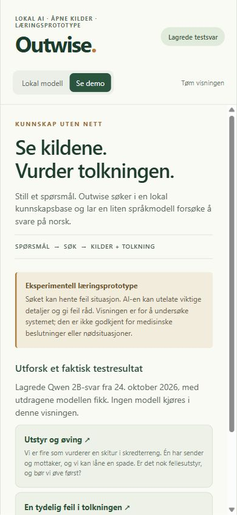
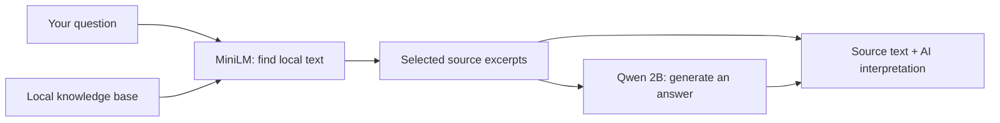
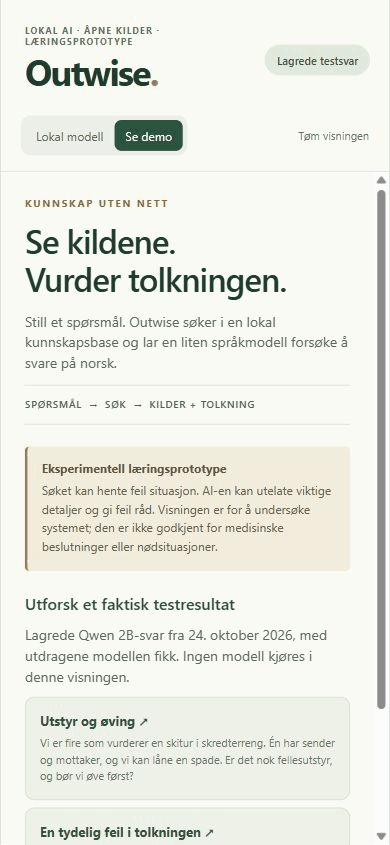

# Outwise

**A small local AI, an offline knowledge base, and an honest look at where RAG breaks down.**

Outwise is a learning prototype for asking outdoor questions in Norwegian without
sending them to a cloud AI. It runs on a Windows PC and has a phone-sized web
interface. The original aim was a useful offline outdoor assistant. Testing showed
that the small models often lost important information or gave incorrect advice.

**The technical pipeline works. Reliable emergency guidance has not been demonstrated.**



## Understand it in one minute

1. You ask a question.
2. A small search model finds text in the local knowledge base.
3. A local language model tries to turn that text into a short answer.
4. The app automatically shows **source excerpts** and **the model's interpretation** separately.

The distinction matters: a useful source can sit next to an incorrect AI answer.
Showing sources makes the experiment inspectable; it does not make the answer safe.



No account or paid AI API is needed to run the application. Models and knowledge
must be installed first locally. The interface looks like a chat, but each question is
processed independently; it has no conversation memory.

## See it without installing a model



The demo replays two **real saved Qwen tests**, with the source excerpts the model
received. It is clearly labeled: no model runs in replay mode. One example shows
useful details alongside unsupported additions; the other shows an incorrect
answer despite a clear source instruction. The recorded walkthrough uses that replay.

[How the demo works and where its data came from](docs/PROTOTYPE.md#demonstration-and-reuse)

## What did the tests show?

We measured whether specific required facts, actions and conditions were fully
present. These are **information-coverage scores**, not percentages of safe answers.

**Full development set: 25 questions, 22 supported situations and 3 knowledge gaps**

| Stage | Required information fully present |
|---|---:|
| Retrieved source context | 55/63 (87.3%) |
| Historical Qwen answers on the same set | 13/63 (20.6%) |

That historical answer run used the earlier prompt/output configuration. Do not
compare it directly with the later screening results below.

**Later comparison: the same 8 questions, including 6 supported situations with 15 requirements**

| Generator | Fully covered requirements | Correct abstention on 2 knowledge gaps |
|---|---:|---:|
| Local Qwen3.5-2B baseline | 8/15 | 0/2 |
| Local Gemma4 E2B baseline | 6/15 | 2/2 |
| GPT-6.1 reference | 13/15 | 2/2 |

The supplied context fully contained 13 of those 15 requirements. GPT preserved all 13;
local models omitted supplied details, mixed situations and changed conditions.
GPT was only an evaluation reference through the existing subscription, not part
of the offline app. Reasoning effort and runtime differed, so this does not isolate
model size. Eight reused development questions are not broad validation.

We also checked the rubric and judge effort, compared embeddings and search/packing
settings, and tested a bounded prompt/sampling improvement round. Those generation
changes produced **no clear overall improvement**. We stopped general optimization
as a project-scope decision, not because better small-model RAG is impossible.

[Simple explanation of the rubric, data, results and limitations →](docs/RESULTS.md)

## What did we learn from research?

Other projects report high scores, but often for multiple-choice questions, short
factual answers, prepared FAQ content or specially trained models. Those results
cannot be equated with complete, free-form first-aid procedures. Similar survival
apps describe local AI and citations; we did not find a publicly documented
quality benchmark directly comparable to ours in the sources reviewed.

Prepared, source-checked answer cards and more specialized models are plausible
alternatives. We did not implement or validate them. A list of source excerpts
plus an interpretation remains an experimental presentation, not a safety fix.

[Studies, similar apps and what their scores actually mean →](docs/RESEARCH.md)

## How it is built

| Part | Technology and role |
|---|---|
| Interface | Expo, React Native, TypeScript; runs in a local browser |
| API | Python, FastAPI; coordinates one question |
| Search | Local multilingual MiniLM embeddings and NumPy index |
| Context | Full-body window ranking, top-16 seeds, source-preserving P3 packing |
| Answer | Qwen3.5-2B Q4_K_M GGUF through llama.cpp, native prompt, thinking off |
| Knowledge | 22 approved URLs; 190 local text chunks in the frozen collection |

The API returns source text and metadata from storage, never model-invented links.
The application profile was checked against24 saved Norway/general cases: seed
ranking and packed excerpts match. The NZ-specific case was excluded because the
app currently uses Norway/general jurisdiction. This is an input parity check,
not a new answer-quality evaluation. Native prompt/tokenization also matched a
saved baseline input. [Exact profile and scope](docs/PROTOTYPE.md)

## Run locally

Requires Windows, Python 3.11+ and Node/pnpm. Initial dependency/model/source setup
needs internet. Model binaries and the full private knowledge collection are not
stored in Git. See [model setup](docs/MODEL_SETUP.md) and
[knowledge setup and reuse terms](docs/KNOWLEDGE_SETUP.md).

```powershell
python -m venv backend/.venv
backend/.venv/Scripts/python.exe -m pip install -e './backend[dev]'
pnpm --dir frontend install --frozen-lockfile
.\scripts\setup-local-model.ps1
.\scripts\setup-knowledge.ps1
.\scripts\start-outwise.ps1
```

Open **http://127.0.0.1:8000**. Choose **Se demo** to inspect the saved examples.
The startup script builds the web interface if needed and serves it from the
local API. The demo itself needs no model/knowledge installation: skip the two
setup scripts when only viewing replay. Browser source links need internet;
the displayed excerpts and core inference are local.

For development and checks: [backend](backend/README.md), [frontend](frontend/README.md).
For the final checks performed and remaining manual review: [verification](docs/VERIFICATION.md).

## Scope and evidence

This is a **learning prototype**, not a completed safety-approved MVP or a native
mobile app. Known errors include critical omissions, incorrect conditions,
unsupported additions and unreliable abstention. Warnings do not correct those
errors. It must not be relied on for medical or emergency decisions.

The original safety layer, independent clinical validation, physical offline
sign-off and final owner approval remain unfinished. [Current work](TASKS.md)

The key methods, result files and research links remain accessible through the
[evidence guide](docs/EVIDENCE.md). Obsolete development files are in a verified,
restorable [historical archive](evals/README.md). Original private raw logs and
source snapshots are preserved locally. [Data and licensing](docs/DATA.md)
